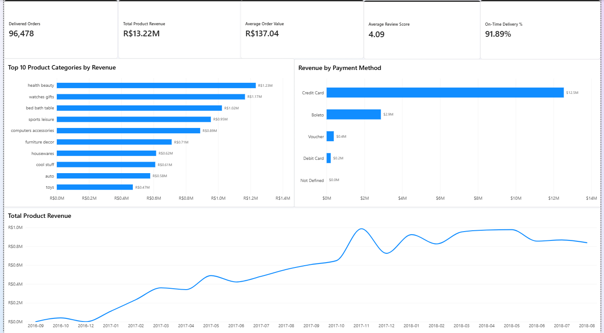
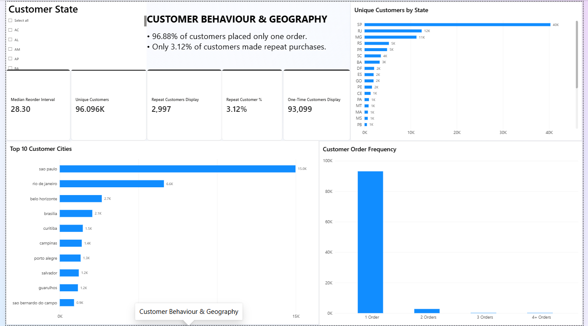
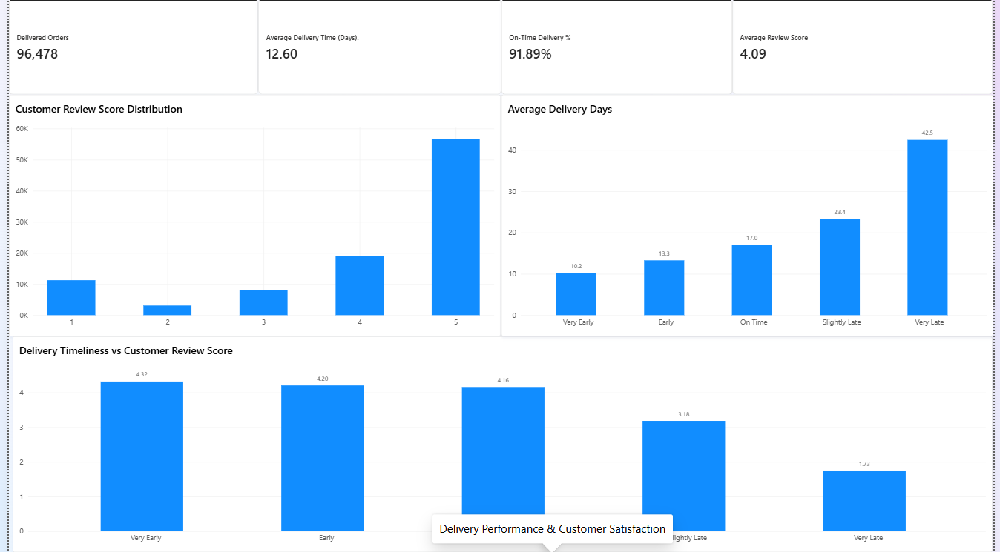

# Olist Brazilian E-Commerce Customer Analytics Dashboard

An end-to-end e-commerce analytics project analyzing customer behaviour, sales trends, payment dynamics, logistics performance, and review satisfaction across 100,000 orders from Olist (Brazil's largest online marketplace).

---

## Table of Contents
- [Project Overview & Business Objectives](#project-overview--business-objectives)
- [Tech Stack](#tech-stack)
- [Dataset & Prerequisites](#dataset--prerequisites)
- [Data Storage & Repository Notice (.gitignore)](#data-storage--repository-notice-gitignore)
- [Architecture & End-to-End Workflow](#architecture--end-to-end-workflow)
- [Methodology & Implementation](#methodology--implementation)
  - [1. Python Data Inspection & Cleaning](#1-python-data-inspection--cleaning)
  - [2. Exploratory Data Analysis (Python EDA)](#2-exploratory-data-analysis-python-eda)
  - [3. SQL Server Business Analysis](#3-sql-server-business-analysis)
  - [4. Power BI Interactive Dashboard & Modeling](#4-power-bi-interactive-dashboard--modeling)
- [Power BI Dashboard Pages & Visuals](#power-bi-dashboard-pages--visuals)
  - [Page 1: Executive Sales & Revenue Overview](#page-1-executive-sales--revenue-overview)
  - [Page 2: Customer Behaviour & Geography](#page-2-customer-behaviour--geography)
  - [Page 3: Delivery Performance & Customer Satisfaction](#page-3-delivery-performance--customer-satisfaction)
- [Key Business Insights & Findings](#key-business-insights--findings)
- [Strategic Business Recommendations](#strategic-business-recommendations)
- [Data Quality & Technical Considerations](#data-quality--technical-considerations)
- [Project Folder Structure](#project-folder-structure)
- [Setup & Execution Instructions](#setup--execution-instructions)

---

## Project Overview & Business Objectives

Olist operates a digital department store marketplace connecting small-to-medium merchants across Brazil with consumer-facing channels. Navigating growth in a fragmented logistics environment requires clear operational visibility.

### Core Objectives:
1. **Sales & Revenue Dynamics:** Quantify Gross Merchandise Value (GMV), shipping fee burdens, seasonality, and product category concentration.
2. **Customer Behaviour & Retention:** Differentiate individual human consumers (`customer_unique_id`) from transactional sessions (`customer_id`) to analyze repeat purchase frequency and geographic concentration.
3. **Payment Preferences:** Map transaction volume and value across Brazilian payment systems (Credit Card, Boleto Bancário, Vouchers, Debit Card) and analyze credit card installment behavior.
4. **Logistics SLA & Customer Satisfaction:** Measure on-time vs. late delivery performance against promised estimated dates, and assess how delivery delays associate with customer review scores.

---

## Tech Stack

| Domain | Technology / Tool | Purpose |
|---|---|---|
| **Data Processing & EDA** | Python 3.13, Pandas, Matplotlib | Data profiling, programmatic cleaning, pipeline exports, and exploratory data analysis. |
| **Database Engineering** | SQL Server 2022 (`.\SQLEXPRESS`), SQLAlchemy, PyODBC | Relational schema design, automated data ingestion (`DECIMAL(10,2)`, `DATETIME2`), and data integrity verification. |
| **Querying & Analytics** | T-SQL (Transact-SQL) | Complex business queries using CTEs, window functions (`SUM() OVER()`, `ROW_NUMBER()`), and conditional aggregations. |
| **Business Intelligence** | Power BI Desktop, DAX | Dimensional data modeling, dynamic DAX KPIs, and interactive 3-page executive reporting. |

---

## Dataset & Prerequisites

The raw data is sourced from the official Kaggle dataset:
* **Source:** [Brazilian E-Commerce Public Dataset by Olist (Kaggle)](https://www.kaggle.com/datasets/olistbr/brazilian-ecommerce)

To run this project locally, download the dataset and extract the following **9 raw CSV files** directly into the **main project root directory** (alongside `README.md`):

1. `olist_customers_dataset.csv`
2. `olist_geolocation_dataset.csv`
3. `olist_orders_dataset.csv`
4. `olist_order_items_dataset.csv`
5. `olist_order_payments_dataset.csv`
6. `olist_order_reviews_dataset.csv`
7. `olist_products_dataset.csv`
8. `olist_sellers_dataset.csv`
9. `product_category_name_translation.csv`

---

## Data Storage & Repository Notice (.gitignore)

To keep this repository lightweight and prevent uploading large data files, **all CSV files are intentionally excluded from GitHub via `.gitignore` (`*.csv`)**:
* **Raw CSV Datasets:** Must be downloaded from Kaggle into the project root as described above.
* **Cleaned Datasets (`cleaned_data/`):** Generated locally by running `clean_data.py`.
* **Intermediate EDA CSV Outputs (`eda_outputs/`, `eda_outputs_part2/`, `eda_outputs_part3/`):** Generated locally by running the three respective EDA scripts.

---

## Architecture & End-to-End Workflow

```
[Raw Olist Data (9 CSVs in root)]
       │
       ▼ (inspect_data.py & clean_data.py)
[Cleaned Datasets (cleaned_data/)]
       │
       ├─────────────────────────────────┬─────────────────────────────────┐
       ▼                                 ▼                                 ▼
[Python EDA Stage]              [Database Engineering]            [Business Intelligence]
 • eda_sales.py                  • load_to_sql.py                  • Power BI Desktop
 • eda_customer_delivery.py      • SQL Server (Olist_Ecommerce)      - Page 1: Sales & Revenue
 • eda_payment_reviews.py        • sql_analysis_queries.sql          - Page 2: Customers & Geo
 (Outputs in eda_outputs 1,2,3)    (7 production SQL queries)        - Page 3: Delivery & CSAT
```

---

## Methodology & Implementation

### 1. Python Data Inspection & Cleaning
* **Inspection (`Python_Scripts/inspect_data.py`):** Inspected shape, datatypes, missing values, duplicated keys, and date validity across all 9 raw CSV files located in the project root.
* **Cleaning Pipeline (`Python_Scripts/clean_data.py`):**
  * Converted timestamp strings to proper `datetime` objects.
  * Preserved leading zeros in 5-digit Brazilian zip codes by casting prefixes to strings.
  * Handled missing values defensively without arbitrary imputation.
  * Saved standardized CSV files into `cleaned_data/`.

### 2. Exploratory Data Analysis (Python EDA)
* **Sales Analysis (`Python_Scripts/eda_sales.py`):** Evaluated delivered orders, product revenue, freight charges, and month-over-month trends (outputs in `eda_outputs/`).
* **Customer & Delivery (`Python_Scripts/eda_customer_delivery.py`):** Calculated unique buyers using `customer_unique_id`, repeat rate, state-level buyer volume, transit durations, and delivery delay distributions (outputs in `eda_outputs_part2/`).
* **Payments & Reviews (`Python_Scripts/eda_payment_reviews.py`):** Evaluated payment method market shares, installment term distributions, review rating percentages (1–5 stars), and the relationship between transit delays and customer ratings (outputs in `eda_outputs_part3/`).

### 3. SQL Server Business Analysis
* **Automated Data Loader (`Python_Scripts/load_to_sql.py`):** Connects to a locally configured SQL Server instance (`.\SQLEXPRESS` / `Olist_Ecommerce`) using SQLAlchemy and an installed ODBC driver (Driver 17/18), creates typed database tables (`DECIMAL(10,2)` for financial fields, `DATETIME2` for dates, and `NVARCHAR(10)` for zip prefixes), and bulk-imports data.
* **Production SQL Queries (`SQL/sql_analysis_queries.sql`):**
  * **Query 1:** Total Orders, Delivered Orders, and Order Status Pipeline breakdown.
  * **Query 2:** Product Revenue vs. Freight Charges across all orders and delivered orders.
  * **Query 3:** 23-month chronological sales and AOV trends.
  * **Query 4:** Top 10 Product Categories by Revenue (translated to English via `category_translation`).
  * **Query 5:** Unique vs. Repeat Customer Dynamics and purchase frequency distribution.
  * **Query 6:** Payment Method volume, total value, average transaction value, and credit card installment tiers.
  * **Query 7:** Delivery fulfillment SLA (On-Time vs. Late) and customer review score association with deduplicated order reviews.

### 4. Power BI Interactive Dashboard & Modeling
* **Data Ingestion:** Connected Power BI Desktop to `.\SQLEXPRESS` (`Olist_Ecommerce`) via **Import Mode**.
* **Data Model & Relationships:** Built a multi-table dimensional model connecting core entities:
  * `category_translation` links to `products` on `product_category_name`.
  * `products` links to `order_items` on `product_id`.
  * `order_items` links to `orders` on `order_id`.
  * `olist_customers_dataset` links to `orders` on `customer_id`.
  * `order_payments` links to `orders` on `order_id`.
* **Review Handling:** Order review metrics are calculated based on review scores associated with orders, accounting for multi-review instances to avoid inflating order and revenue totals.
* **Key DAX Measures:**
  * **Delivered Product Revenue:** `CALCULATE(SUM(order_items[price]), orders[order_status] = "delivered")`
  * **Average Order Value (AOV):** `DIVIDE([Delivered Product Revenue], [Delivered Orders])` = **R$ 137.04** (excluding freight).
  * **On-Time Delivery %:** Percentage of delivered orders delivered on or before the estimated date.

---

## Power BI Dashboard Pages & Visuals

The completed Power BI report is saved in `PowerBI/olist_customer_analytics_dashboard.pbix`.

### Page 1: Executive Sales & Revenue Overview



* **Top KPI Strip:**
  * **Delivered Orders:** `96,478`
  * **Total Product Revenue:** `R$ 13.22M`
  * **Average Order Value (AOV):** `R$ 137.04`
  * **Average Review Score:** `4.09 / 5.0`
  * **On-Time Delivery %:** `91.89%`
* **Visuals:**
  * *Top 10 Product Categories by Revenue:* Horizontal bar chart showing category leaders (`Health & Beauty`, `Watches & Gifts`, `Bed, Bath & Table`).
  * *Revenue by Payment Method:* Financial value distribution across credit cards, boletos, vouchers, and debit cards.
  * *Total Product Revenue by Year-Month:* Line chart illustrating steady growth across 2017–2018 and the November 2017 Black Friday peak.

---

### Page 2: Customer Behaviour & Geography



* **Top KPI Strip & Callouts:**
  * **Unique Customers:** `96,096`
  * **One-Time Customers:** `93,099` (96.88%)
  * **Repeat Customers:** `2,997` (3.12%)
  * **Repeat Customer %:** `3.12%`
  * **Median Reorder Interval:** `28.30 days`
* **Visuals:**
  * *Customer State Slicer & Callout Card:* Interactive state filtering.
  * *Unique Customers by State:* Geographic concentration showing São Paulo (`SP`) representing ~42% of customer volume, followed by `RJ`, `MG`, and `RS`.
  * *Top Customer Cities:* City-level distribution led by São Paulo and Rio de Janeiro.
  * *Customer Order Frequency:* Column distribution demonstrating that 96.9% of customers placed a single order.

---

### Page 3: Delivery Performance & Customer Satisfaction



* **Top KPI Strip:**
  * **Delivered Orders:** `96,478`
  * **Average Delivery Time:** `12.60 days`
  * **On-Time Delivery %:** `91.89%`
  * **Average Review Score:** `4.09 / 5.0`
* **Visuals:**
  * *Customer Review Score Distribution:* Bar chart of ratings from 1 to 5 stars (5-star reviews dominate at ~58%).
  * *Average Delivery Days by Delivery Delay Category:* Average delivery transit days across fulfillment categories (*Very Early*, *Early*, *On Time*, *Slightly Late*, *Very Late*).
  * *Delivery Timeliness vs. Customer Review Score:* Visual demonstration of the rating drop from on-time deliveries down to severely delayed deliveries.

---

## Key Business Insights & Findings

1. **Revenue & Basket Size:**
   * Delivered product sales generated **R$ 13,221,498.11** across **96,478 orders**.
   * Average Order Value (AOV) is **R$ 137.04** per delivered order (excluding shipping fees).
   * Shipping charges contributed an additional **~R$ 2.18M – R$ 2.20M**, representing approximately **14.1% to 14.2%** of total customer outlay.

2. **Customer Acquisition vs. Retention:**
   * Across **96,096 unique buyers**, **93,099 (96.88%)** placed only one order.
   * Only **2,997 (3.12%)** are repeat buyers. The platform operates primarily on first-time customer acquisition.
   * Repeat customers who do return reorder relatively quickly (median interval of **28.3 days**).

3. **Payment Dynamics & Installments:**
   * **Credit Card** is the dominant payment channel, capturing **73.9% of transactions** and **78.3% of total payment value**.
   * **Boleto Bancário** is the secondary channel (**19.0% of transactions**, **17.9% of value**), confirming that cash-based/voucher payments remain critical for Brazilian consumers.
   * Installments drive larger baskets: transactions split into 10 installments show an average order value more than double that of single-payment orders.

4. **Fulfillment SLA & Geographic Spread:**
   * **91.89%** of delivered orders meet or beat the promised delivery date.
   * Fulfillment times vary significantly by geography: Southeast states (e.g., SP ~8–9 days) receive fast delivery due to seller proximity, whereas Northern/Northeastern states (e.g., RR, AP) experience transit times averaging 25+ days.

5. **Logistics & Customer Review Score Association:**
   * Orders delivered **on time** have an average satisfaction rating of **4.29 / 5.0** (with ~82.8% positive 4–5 star reviews).
   * Orders delivered **late** experience a steep drop in customer ratings to **2.57 / 5.0** (with negative 1–2 star reviews rising to ~54.1%).
   * *Conclusion:* Punctual delivery is the strongest operational correlate of positive customer reviews on the platform.

---

## Strategic Business Recommendations

1. **Focus on Customer Retention Opportunities:**
   * Because **96.88%** of customers currently buy only once, business performance is heavily dependent on continuously acquiring first-time buyers.
   * Introducing loyalty programs, targeted post-purchase communication around the 30-day window (aligning with the 28.3-day median reorder interval), and category cross-selling could potentially reduce dependence on new-customer acquisition and improve Customer Lifetime Value (LTV).

2. **Mitigate Regional Delivery Delays:**
   * Because delayed deliveries show a strong association with lower review scores (dropping from **4.29 to 2.57**), improving fulfillment in slower regions (such as the North and Northeast) represents a key operational priority to protect customer satisfaction.

3. **Promote Strategic Installments on Higher-Priced Categories:**
   * Higher installment terms (e.g., 6–10 installments) correlate with substantially higher basket sizes. Partnering with payment gateways to offer subsidized installment promotions on premium categories (such as *Computers & Accessories* and *Watches & Gifts*) could help drive average order sizes.

---

## Data Quality & Technical Considerations

* **Customer vs. Order Entity:** In Olist, `customer_id` is generated uniquely per order session, whereas `customer_unique_id` identifies the actual individual consumer. Grouping by `customer_unique_id` is essential for retention metrics (identifying exactly **96,096 unique customers**).
* **Review Deduplication:** Approximately 550 orders have multiple review entries submitted over time. In our SQL queries and Power BI model, reviews are deduplicated to the latest review per order (`review_creation_date` / `review_answer_timestamp`) before joining with order facts to prevent revenue and order count inflation.
* **Delivery Performance Denominator:** Out of 96,478 delivered orders, **8 orders** lack an actual customer delivery timestamp. These 8 records are excluded from delivery SLA calculations, yielding a verified delivery denominator of **96,470 orders**.
* **Freight Revenue Figures (Python vs. SQL):**
  * SQL Query 2 reports delivered freight charges of **R$ 2,177,877.10** (`SUM(oi.freight_value)` on delivered orders).
  * Python `eda_sales.py` reports delivered freight charges of **R$ 2,198,275.64**.
  * Both figures are reported transparently. This numerical discrepancy between the Python processing pipeline and the SQL Server queries remains unresolved in the source scripts. Both environments report identical product revenue of **R$ 13,221,498.11**.
* **Association vs. Causation:** Review scores and delivery delays are reported as an observed statistical association rather than definitive causal proof, acknowledging that product quality, packaging, and seller communication also influence ratings.

---

## Project Folder Structure

```text
Ecommerce-Customer-Analytics/
│
├── README.md                                  # Project showcase & documentation
│
├── PowerBI/
│   └── olist_customer_analytics_dashboard.pbix # Interactive 3-page Power BI Dashboard
│
├── SQL/
│   └── sql_analysis_queries.sql               # 7 verified production T-SQL business queries
│
├── Python_Scripts/
│   ├── inspect_data.py                        # Dataset inspection & quality profiling script
│   ├── clean_data.py                          # Data cleaning & standardization pipeline
│   ├── load_to_sql.py                         # SQL Server database loader & table creator
│   ├── eda_sales.py                           # EDA Part 1: Sales, GMV, and Category Analysis
│   ├── eda_customer_delivery.py               # EDA Part 2: Customer Behaviour & Logistics SLA
│   └── eda_payment_reviews.py                 # EDA Part 3: Payment Methods & Review Scores
│
├── Dashboard_Screenshots/
│   ├── 01_Executive_Sales_Revenue_Overview.png
│   ├── 02_Customer_Behaviour_Geography.png
│   └── 03_Delivery_Performance_Customer_Satisfaction.png
│
├── Documentation/                             # Reserved for additional project notes
│
├── cleaned_data/                              # 9 cleaned CSV datasets (generated locally)
│   ├── olist_customers_dataset.csv
│   ├── olist_geolocation_dataset.csv
│   ├── olist_orders_dataset.csv
│   ├── olist_order_items_dataset.csv
│   ├── olist_order_payments_dataset.csv
│   ├── olist_order_reviews_dataset.csv
│   ├── olist_products_dataset.csv
│   ├── olist_sellers_dataset.csv
│   └── product_category_name_translation.csv
│
├── eda_outputs/                               # Part 1 EDA summaries & charts (generated locally)
├── eda_outputs_part2/                         # Part 2 EDA summaries & charts (generated locally)
├── eda_outputs_part3/                         # Part 3 EDA summaries & charts (generated locally)
│
└── [Root Raw CSVs]                            # 9 downloaded Kaggle CSVs (ignored via .gitignore)
```

---

## Setup & Execution Instructions

### 1. Prerequisites
* **Python 3.10+**
* **Local SQL Server Instance** (SQL Server 2019/2022 Express or Developer Edition) with **SQL Server Management Studio (SSMS)**
* **ODBC Driver for SQL Server** (ODBC Driver 17 or 18 installed locally)
* **Power BI Desktop**

### 2. Python Environment Setup
```powershell
# 1. Clone the repository and navigate into the project directory
git clone https://github.com/<your-username>/Ecommerce-Customer-Analytics.git
cd Ecommerce-Customer-Analytics

# 2. Create a fresh virtual environment
python -m venv venv

# 3. Activate the virtual environment
# On Windows (PowerShell):
.\venv\Scripts\Activate.ps1
# On Linux/macOS:
source venv/bin/activate

# 4. Install required dependencies
pip install pandas matplotlib sqlalchemy pyodbc
```

### 3. Sequential Python Pipeline Execution
Run the six Python scripts in the exact sequence below:

```powershell
# Step 1: Inspect and profile the 9 raw CSV datasets placed in the project root
python Python_Scripts/inspect_data.py

# Step 2: Clean and standardize data types, saving output files to cleaned_data/
python Python_Scripts/clean_data.py

# Step 3: Run sales, revenue, and product category analysis, saving to eda_outputs/
python Python_Scripts/eda_sales.py

# Step 4: Run customer retention, reorder frequency, and delivery analysis, saving to eda_outputs_part2/
python Python_Scripts/eda_customer_delivery.py

# Step 5: Run payment method, installment distribution, and review score analysis, saving to eda_outputs_part3/
python Python_Scripts/eda_payment_reviews.py

# Step 6: Connect to your local SQL Server instance and bulk-load the cleaned datasets
python Python_Scripts/load_to_sql.py
```

*Note on Step 6:* `load_to_sql.py` connects to your locally running SQL Server instance (configured for `.\SQLEXPRESS` and database `Olist_Ecommerce`). Ensure SQL Server is running and you have created the target database beforehand:
```sql
CREATE DATABASE Olist_Ecommerce;
```

### 4. Running SQL Business Queries
Open `SQL/sql_analysis_queries.sql` in SQL Server Management Studio (SSMS) and execute the 7 verified analytical queries against `Olist_Ecommerce`.

### 5. Viewing the Power BI Dashboard
1. Open `PowerBI/olist_customer_analytics_dashboard.pbix` in Power BI Desktop.
2. If prompted for data source credentials, connect using Windows Authentication to your local SQL Server instance `.\SQLEXPRESS` (`Olist_Ecommerce`).
3. Refresh the dataset or interact directly with the 3 report pages.

---

## Author & Acknowledgements
* **Dataset:** [Brazilian E-Commerce Public Dataset by Olist (Kaggle)](https://www.kaggle.com/datasets/olistbr/brazilian-ecommerce)
* **Project Type:** End-to-End Data Analytics Portfolio Project (Python + SQL Server + Power BI).
